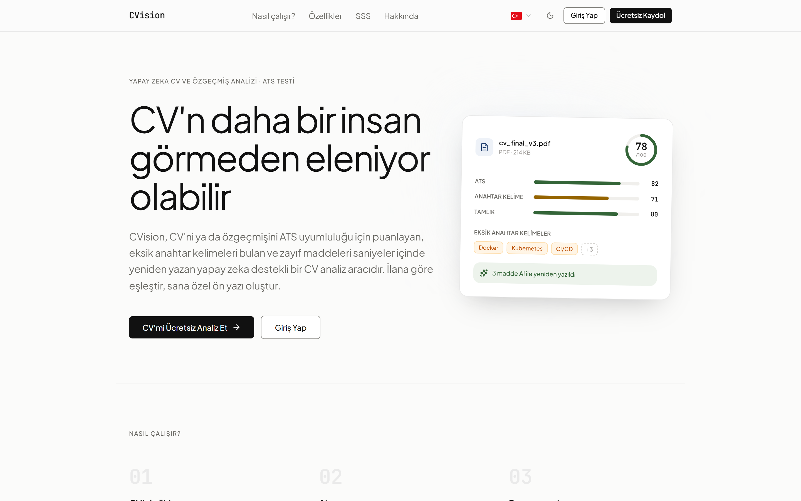
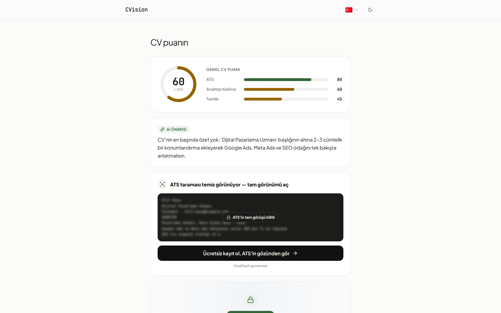
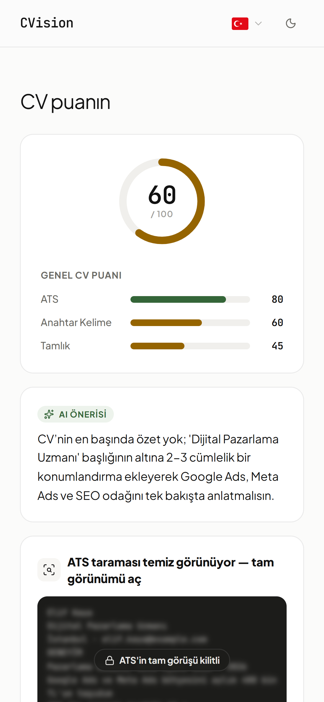

# CVision

**AI-powered CV analysis and ATS check.** Upload a CV and see how an applicant
tracking system reads it, what it scores, and what to fix before you apply.

Live at **[cvisionapp.com](https://www.cvisionapp.com)**. Try it without an account.

---

## What it does

- **Free check without signing up.** Upload a PDF on `/try` and get a score and
  the first suggestion in about 30 seconds.
- **Score out of 100.** The score combines five parts: section completeness, relevant
  skills, ATS compatibility, keywords for the target field, and experience.
- **ATS X-Ray.** Shows the plain text a parser pulls out of the PDF. Image-only
  pages and multi-column layouts that come out jumbled or empty are flagged.
- **Prioritized suggestions.** AI-written, ordered by what matters most for
  this CV.
- **Bullet rewrites.** Weak bullets come back stronger. CVision never invents a
  number; it leaves a placeholder like `[N]` for you to fill in.
- **Job match.** Paste a job posting or its URL to get a match rate, the skills
  the CV is missing, and a tailored cover letter.
- **Career suggestions.** Roles that fit the profile.
- **Five languages.** Turkish, English, German, Spanish and French.

| Analysis result | On mobile |
|---|---|
|  |  |

The screenshots use an invented demo CV. The scores and the suggestion are what
CVision actually produced for it.

---

## How the score works

The overall score is a weighted average:

| Part | Weight | What it measures |
|---|---|---|
| Completeness | 25% | Summary, experience, education, skills and other sections |
| Skills | 25% | Skills relevant to the target role, with a capped bonus for the rest |
| ATS | 20% | 10 checks: contact details, length, action verbs, single column, machine-readable text and more |
| Keywords | 15% | Terms expected in the target field |
| Experience | 15% | Depth of work experience |

The rule-based engine calculates every score; the language model never sets one.
The model helps the engine recognize skills and keywords written in different
ways. It also writes the summary and suggestions, rewrites bullets and drafts
cover letters.

---

## How it works

1. The PDF is uploaded and processed in the background
   (`pending → processing → completed`).
2. PyMuPDF extracts the text and checks for image-only pages and column
   interleaving.
3. The analysis engine detects sections, runs the ATS checks, and matches skills
   and keywords against role profiles.
4. OpenAI adds the summary, suggestions and rewrites.
5. Results are stored per user. Anonymous `/try` results can be claimed after
   signing up.

---

## Tech stack

**Backend:** Python 3.11, FastAPI, SQLAlchemy and Alembic, PostgreSQL
(Supabase; SQLite for local development), PyMuPDF, OpenAI, trafilatura (job
posting URLs), slowapi (rate limiting), JWT and Google sign-in, Resend (email),
Sentry.

**Frontend:** React 19, TypeScript, Vite, Tailwind CSS 4, i18next, React Router.
Public pages are prerendered at build time for SEO.

**Hosting:** Vercel (frontend), Render (API), Supabase (database).
Payments run on Lemon Squeezy with a credit system: new accounts get 3 credits
(one full analysis), every account gets 2 more each week, and credit packs can
be bought.

---

## License

Copyright (C) 2026 Fatih Çatalçam

Licensed under the **GNU Affero General Public License v3.0** — see [LICENSE](LICENSE).

The source is open to read, learn from and contribute to. The AGPL adds one
condition beyond the GPL that matters for a hosted product like this one: if you
run a modified version of CVision as a network service, you have to make your
modified source available to its users. Running the unmodified project, or using
it privately, carries no such obligation.

CVision is also operated as a commercial service at
[cvisionapp.com](https://www.cvisionapp.com); the licence covers this source
code, not the hosted service or the CVision name.
